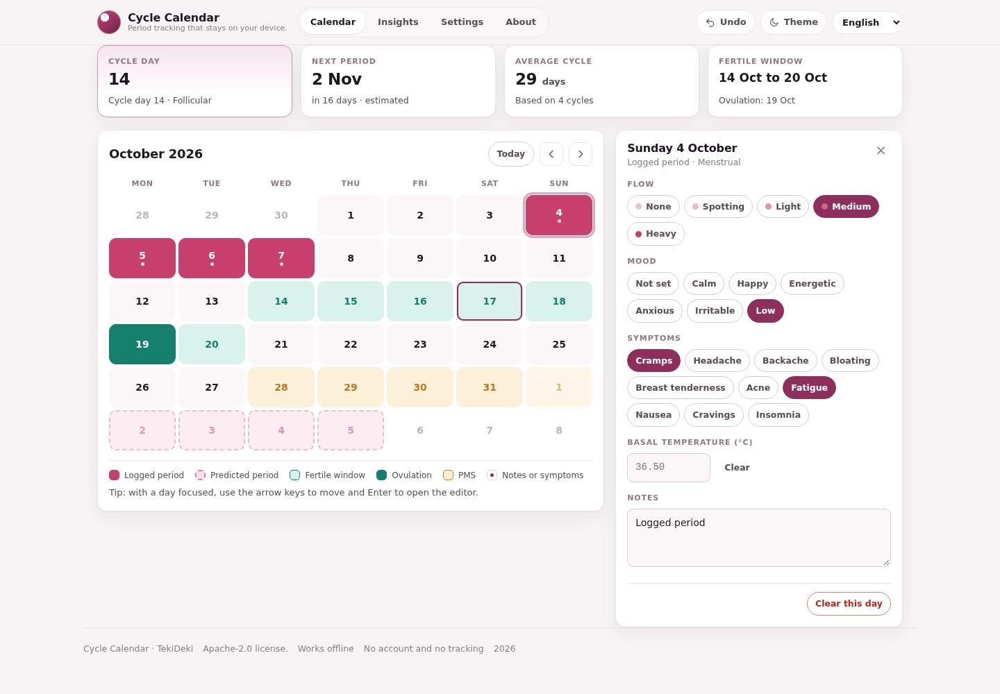
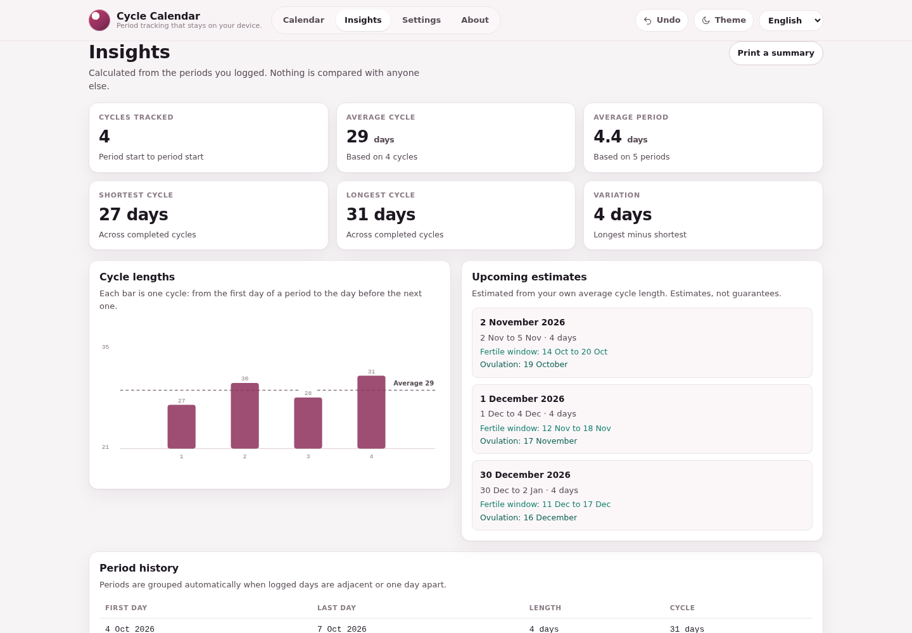
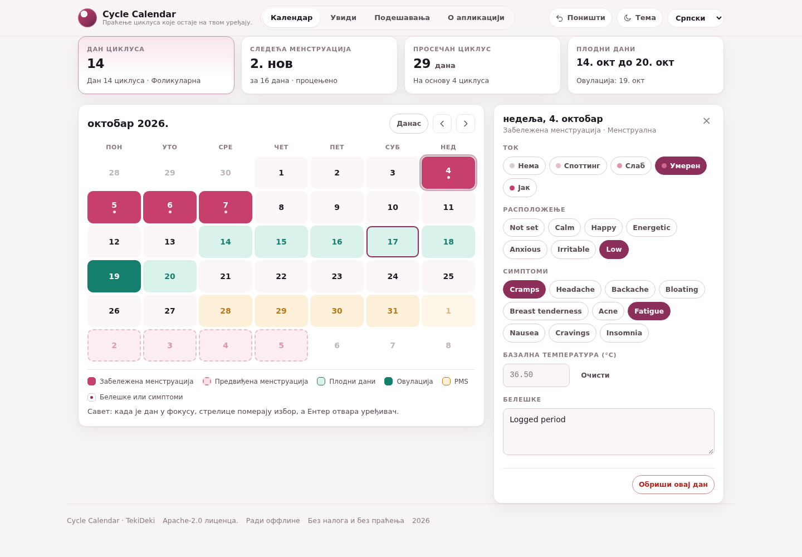
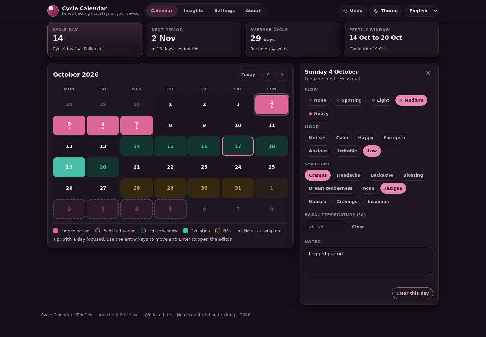

# Cycle Calendar · TekiDeki

A menstrual calendar that runs entirely in your browser. Log the days you bleed with a flow level, add symptoms, mood, a note and your basal temperature, and the app groups those days into periods, predicts the next ones from your own averages, and shades the estimated fertile window, ovulation day and PMS window. No account, no backend, no CDN, no analytics: what you write about your body stays on your device.

[Live app](https://tekideki.github.io/Cycle-Calendar/) · [Apache-2.0](LICENSE) · [Support with a coffee](https://paypal.me/TekiDeki)



## What it does

- **A calendar you can read at a glance.** Logged periods are solid, predicted periods are dashed, the fertile window is green, estimated ovulation is the darker green day, and the five days before a predicted period are shaded amber as a PMS hint. Every state is a colour *and* a shape, so the grid still works in greyscale, and the legend spells all six states out.
- **Flow in five levels.** None, spotting, light, medium, heavy. Contiguous days with flow form one period; a gap ends it, because what you logged should be what you get back.
- **Symptoms and mood.** Ten common symptoms (cramps, headache, backache, bloating, breast tenderness, acne, fatigue, nausea, cravings, insomnia) and six moods, each stored per day. The Insights tab counts which ones you log most often.
- **Basal temperature.** Optional per day, in °C, validated to a plausible range. It is stored and shown but never used to *claim* ovulation: that would need a real chart and a clinician.
- **Notes.** A short free-text note per day, saved as you type.
- **Predictions from your own history.** The average cycle length is the mean gap between your last six period starts, the average period length the mean of your last six periods. With fewer than two cycles the defaults from Settings are used. The next three periods, their fertile windows and estimated ovulation are drawn straight onto the calendar.
- **Insights.** Completed cycles, average cycle and period, shortest and longest cycle, the variation between them, a bar chart of every cycle length, and a table of the full period history.
- **Export, import, print.** A backup is plain JSON with your days and settings; import validates it as a whole and refuses a file that is not ours instead of half wiping your diary. *Print summary* produces a clean one-page sheet for an appointment.
- **Undo.** Every change is reversible from the header button or `Ctrl+Z` / `Cmd+Z`, including a full erase.
- **English, Română, Srpski (Latin), Српски (Cyrillic).** The app ships in English; the selector in the header lists all four and remembers your choice. Serbian Cyrillic is generated by deterministic transliteration of the Serbian Latin table (see `build.py`), never translated separately, so the four locales are structurally identical.
- **Light and dark theme**, keyboard navigation of the grid (arrow keys move, `Enter` opens the editor), visible focus, screen-reader labels for every day, reduced-motion friendly styles.
- **Works offline** after the first visit: an installable PWA with a cached app shell that never needs a network request.

| Calendar | Insights |
| --- | --- |
|  |  |

| Serbian Cyrillic | Dark theme |
| --- | --- |
|  |  |

## What happens to your data

Everything is written to `localStorage` under the key `cycle-calendar.v1` on this device. There is no account, no server, no synchronisation, no telemetry and no third-party request at runtime. The page is one HTML file with the CSS, the engine and all four locales inlined, so opening it triggers no network traffic at all beyond the document itself.

The only ways data leaves the browser are the ones you start: *Export backup* writes a JSON file you choose where to keep, and *Print summary* hands the sheet to your printer. Clearing site data, or using a private window and closing it, removes everything, which is also the honest downside: **if you clear your browser data without a backup, the history is gone.**

If you want to confirm nothing leaves: open DevTools, go to the Network panel, log a period. There is nothing to see.

## How the predictions work, and where their limits are

- **Average cycle** is the arithmetic mean of the gaps between consecutive period starts, using your last six completed cycles, kept inside 21 to 45 days. **Average period** is the mean length of your last six periods, kept inside 1 to 12 days.
- **Ovulation** is estimated *backwards* from the predicted next period, using the luteal phase length from Settings (14 days by default), because the luteal half of a cycle is the more stable one. The **fertile window** covers the five days before that estimate plus the day itself.
- **Logged days always win.** A predicted period never paints over a period you actually logged, and the current cycle day is counted from the last real start.
- **A stale history is skipped, not repeated.** If the last period you logged is months old, the predictions roll forward to the first period that has not ended yet rather than showing a wall of dates in the past.

Honest limitations, stated up front:

- **This is not a contraceptive and not a diagnosis.** It does not measure hormones, it cannot confirm ovulation, and cycle dates move with stress, illness, travel, sleep and medication. Do not use it to decide whether you can become pregnant.
- **Irregular cycles make everything fuzzy.** The maths assumes a fairly stable recent history; with a wide variation the estimate is a guess dressed as a date. The variation figure in Insights is there so you can see how wide yours is.
- **One device, one browser profile.** There is no sync by design. Use *Export backup* to move your history to another device, and *Import backup* to bring it back.
- **No import from other trackers.** Only Cycle Calendar's own JSON format is accepted; a foreign file is rejected rather than guessed at.
- **The chart shows cycle lengths, not a medical trend.** It is a bar per completed cycle, nothing smoothed or modelled.
- **Notes are capped** at 600 characters per day and 500 when restored from a backup, which keeps the storage size predictable.

## Files

| File | What it is |
| --- | --- |
| `index.html` | The built, self-contained app. This is what GitHub Pages serves. Do not edit by hand. |
| `build.py` | Deterministic build: inlines the sources, generates the Serbian Cyrillic locale, runs the checks, writes `index.html`. |
| `src/template.html` | Markup for the four views, the editor, the legend and the print report. |
| `src/styles.css` | All styles, both themes, responsive rules, print rules, reduced-motion rules. |
| `src/cycle.js` | The engine: dates, period grouping, statistics, predictions, fertile window, backup validation. Pure functions, no DOM, no storage. |
| `src/app.js` | UI logic, storage, i18n, rendering, event wiring. |
| `src/i18n/locales.json` | `en`, `ro` and `sr-latn`; `sr-cyrl` is generated at build time. |
| `tests/logic_test.cjs` | 139 assertions on the engine, the locale tables and the built file. |
| `tests/build_test.py` | 61 assertions on the build: transliteration, determinism, packaging, text hygiene. |
| `tests/ui_test.py` | 71 Playwright checks on desktop and touch tablet, zero console errors. |
| `tools/make_icons.py` | Draws the icon set and the favicon locally, no external assets. |
| `tools/make_screenshots.py` | Captures the README screenshots and composes `screenshots/og.png`. |
| `sw.js` | Service worker, offline app shell. `VERSION` matches `VERSION` and is bumped on every release. |
| `manifest.json` | PWA manifest, icons, maskable icon. |
| `screenshots/` | Desktop, tablet, insights, Cyrillic, dark theme and the social image. |
| `LICENSE`, `NOTICE` | Apache-2.0 and the third-party notice (there is no third-party code). |

## Develop

```bash
python3 build.py          # writes index.html, prints size, locales and version
node tests/logic_test.cjs # engine, locale and build checks
python3 tests/build_test.py
python3 tests/ui_test.py  # Playwright end to end, desktop + tablet
```

Playwright is only needed for the UI test, and `tests/ui_test.py` starts its own local server if one is not already running:

```bash
pip install playwright
python3 -m playwright install chromium
python3 -m playwright install-deps chromium
```

The build is byte-identical for the same inputs: no timestamps, no random values, no environment data. It refuses to write a file that contains an em dash, an en dash, a byte order mark, unbalanced locale keys, mismatched placeholders, an empty string, an unknown translation key, or a literal `</script` inside an inlined script. It also refuses to inline anything that still references a local stylesheet or script, so the shipped file is always exactly one document.

## Design notes

- **Colour and shape, always together.** Period solid, prediction dashed, fertile tinted, ovulation filled, PMS tinted amber. Nothing relies on hue alone.
- **No framework.** The engine is a plain IIFE that is loaded twice on purpose: as a `<script>` in the browser and with `require()` in Node, so the tests exercise exactly the code the app ships.
- **Dates are strings.** Every date is a `YYYY-MM-DD` string converted to UTC midnight, so a cycle never shifts by a day because of a timezone or a daylight saving change.
- **English first.** Unlike the other TekiDeki apps, this one ships in English and does not guess a language from the browser, because `navigator.language` is shared by everyone using the device. The choice is explicit and remembered.

## Licence

Apache License 2.0. See [LICENSE](LICENSE) and [NOTICE](NOTICE).

## Support

[paypal.me/TekiDeki](https://paypal.me/TekiDeki) - or just star the repository.
